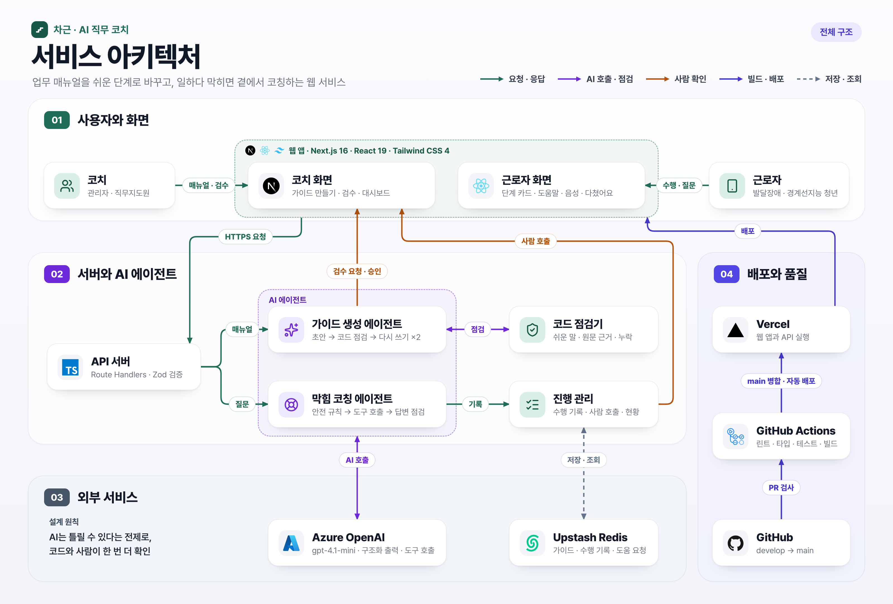

# 차근 (chageun-job-coach)

발달장애·경계선지능 청년의 첫 직장 적응을 돕는 AI 직무 코치

업무 매뉴얼을 쉬운 단계 카드로 바꾸고, 일하다 막힐 때 곁에서 쉬운 말로 코칭

## 핵심 흐름

1. 코치(관리자·직무지도원)의 업무 매뉴얼 입력
2. AI의 쉬운 단계 카드 변환과 자체 점검
3. 코치의 검수·승인
4. 근로자의 단계별 수행, 막히면 AI 코칭 또는 사람 호출
5. 코치의 진행 상황 확인

## 아키텍처



- AI가 만든 단계는 코드 점검과 코치 승인을 거쳐야 근로자 화면에 표시
- 코칭 답변은 승인된 단계와 원문 범위로 한정, 모르는 질문과 다쳤다는 말은 사람 호출
- 계층별 책임과 의존 방향: [docs/architecture.md](docs/architecture.md)

## 시작하기

요구 사항: Node.js 20.9 이상

```bash
npm install
cp .env.example .env.local   # Azure OpenAI 또는 OpenAI 값 입력
npm run dev
```

| 명령            | 용도                      |
| --------------- | ------------------------- |
| `npm run dev`   | 개발 서버                 |
| `npm run check` | lint + 타입 검사 + 테스트 |
| `npm run build` | 프로덕션 빌드             |

## 문서

- 제품 정의: [docs/product.md](docs/product.md)
- 아키텍처: [docs/architecture.md](docs/architecture.md)
- 개발 규칙: [AGENTS.md](AGENTS.md)

## 브랜치

- `main`: 배포본
- `develop`: 통합 브랜치
- 작업 브랜치: `develop`에서 분기 (`type/#이슈번호-description`)

## Credits / Licenses

| 명칭         | 라이선스   | 용도              |
| ------------ | ---------- | ----------------- |
| Next.js      | MIT        | 웹 프레임워크     |
| React        | MIT        | UI 라이브러리     |
| Tailwind CSS | MIT        | 스타일            |
| OpenAI Node  | Apache-2.0 | OpenAI API 호출   |
| Zod          | MIT        | 입력·AI 출력 검증 |
| Lucide       | ISC        | 아이콘            |
| Vitest       | MIT        | 테스트            |
| ESLint       | MIT        | 린트              |
| Prettier     | MIT        | 코드 포맷         |
| TypeScript   | Apache-2.0 | 타입 검사         |

전체 목록과 링크: [docs/credits.md](docs/credits.md)
